# Braindelay Guitar Tools

A tool to help guitarists learn scales, chord voicings, and progressions. Visualise any scale on a 19-fret fretboard, explore diatonic chord shapes, build chord progressions with audio playback, keep time with the built-in metronome, and work through structured soloing exercises.

**NOTE:** This is still in closed testing, if you want to download a preview version, the details are in [CLOSED_TESTING.md](CLOSED_TESTING.md)

## Usage Guide

### Scales

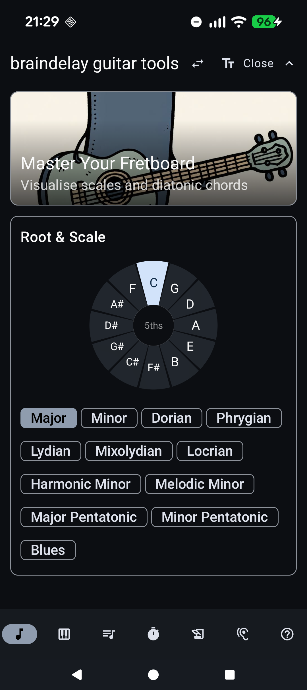

1. **Choose a root note** — tap any of the 12 chromatic notes in the Root & Scale card.
2. **Choose a mode** — tap a mode chip (Major, Minor, Dorian, Harmonic Minor, Major/Minor Pentatonic, Blues, etc.).
3. The fretboard updates immediately, showing every scale note labelled with Roman numeral degrees (I–VII). Root notes appear in a distinct colour.
4. **Collapse the selector** — tap the arrow in the top bar to hide the Root & Scale panel and focus on the fretboard. Tap again to restore it.

In **portrait** the Root & Scale card stacks vertically — a large Circle of Fifths on top, with the mode chips wrapping over multiple rows beneath it. In **landscape** the circle sits on the left and the mode chips fill the remaining width on the right.

#### Pentatonic and Blues scales

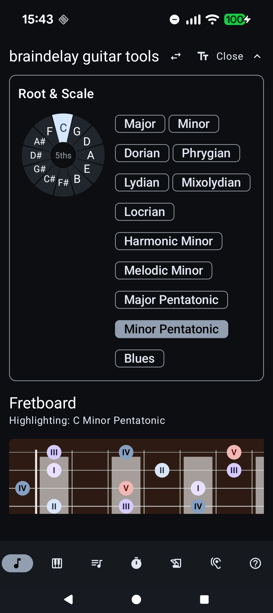

- **Major Pentatonic** (1–2–3–5–6), **Minor Pentatonic** (1–b3–4–5–b7), and **Blues** (1–b3–4–b5–5–b7) sit alongside the seven-note modes.
- Roman numerals show only the available degrees (5 or 6 instead of 7). Equivalent intervals share colours with the parent diatonic mode; the **b5** in the Blues scale is highlighted in the error colour.
- The **Diatonic Chords** sidebar is hidden for these scales — classical diatonic harmony does not apply. The chord voicing picker still opens on tap, but no voicings are flagged diatonic.
- **Templates** in the Progression screen fall back to the parallel major or minor key.

#### Fretboard options (top bar icons)
| Icon | Action |
|------|--------|
| ⇄ | Toggle **left-handed mode** — mirrors the fretboard so the nut is on the right |
| T | Toggle **label mode** — switches note labels between Roman numerals (I, b3…) and note names (C, C#…) |

#### Chord voicings

- **Tap any highlighted note** on the fretboard to open a chord type picker at the bottom of the screen.

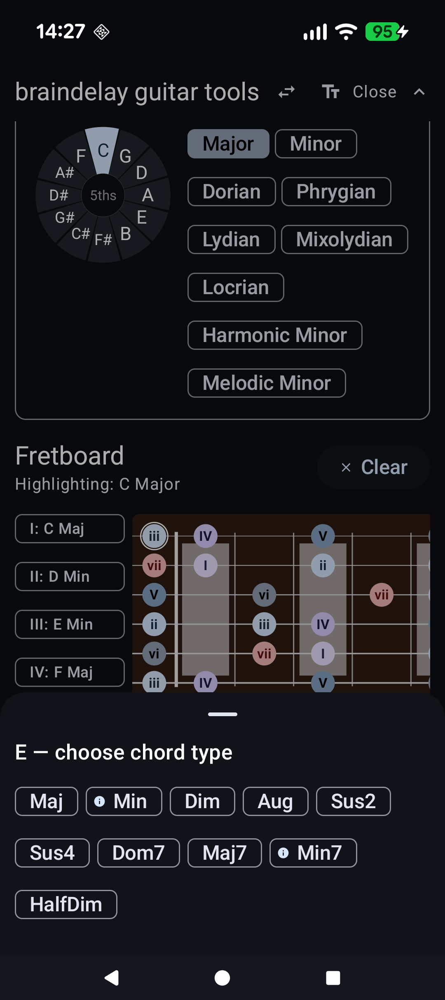

- Select a chord type to overlay its tones on the fretboard (colour-coded R / 3 / 5 / 7).

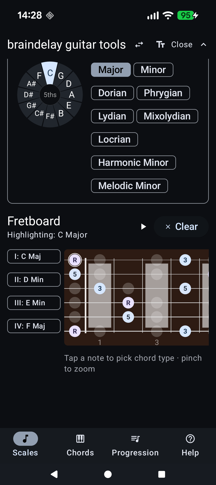

- Tap **▶** (Play) to hear the chord via synthesised audio.
- Diatonic chord types for the tapped note are marked with a dot (●).
- Press **Clear**, or tap outside the picker, to reset the overlay.

#### Arpeggio overlays
- In the **Diatonic Chords** card, tap any chord chip (e.g. "II: D Min") to highlight the full 1-3-5-7 arpeggio of that chord across the entire fretboard.
- A summary card shows the chord name, quality, and constituent notes.
- Tap the chip again or press **Clear** to remove the overlay.

#### Fullscreen mode
- Tap anywhere on the fretboard that is **not** a highlighted note to enter fullscreen zoom.
- Tap **Go Back** to return to the normal view.

---

### Chords

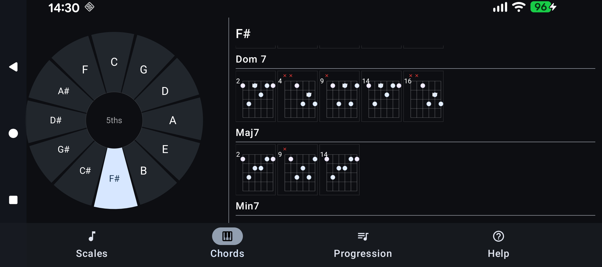

In portrait, the circle of fifths sits at the top and the chord list fills the lower half. In landscape, they sit side by side.

1. **Tap a note** on the circle of fifths to set the root.
2. The chord list shows all 29 chord types — scroll vertically to browse them.
3. Each chord type section contains a horizontally scrollable row of voicing diagrams.
4. **Tap any diagram** to hear it played back.
5. **Tap +** next to any chord type label to add that chord directly to the Progression.

#### Custom chord builder

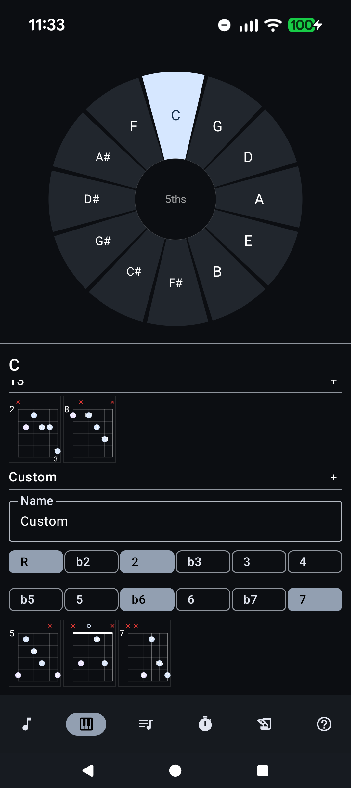

Scroll to the bottom of the chord list to find the **Custom** section.

1. Give the chord a **Name** in the text field.
2. **Toggle interval buttons** to build the chord — tap any of the 12 semitones (R, b2, 2 … 7) to add or remove them. Deselecting **R** generates rootless voicings (useful for jazz shells like 3-5-b7).
3. **Reorder the selected tones** — every picked interval appears in a row beneath the grid with **◀ ▶** arrows; use them to swap a tone with its neighbour and define the order it is stored in.
4. Voicing diagrams generate automatically once two or more intervals are selected. **Tap any diagram** to hear it.
5. Tap **+** to add the custom chord to the Progression.

---

### Progression

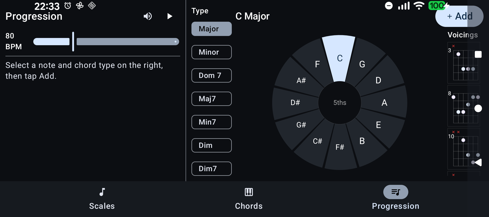

The chord selector shows the circle of fifths on the left, chord type chips in the middle, and example voicings on the right. In portrait the selector and progression list are stacked; in landscape they sit side by side.

#### Building a progression
1. **Tap a note** on the circle of fifths to set the root.
2. **Select a chord type** from the chip list.
3. Press **Add** to append the chord to the progression list.
4. Use **− / +** to adjust how many beats each chord lasts (1–8).
5. Use the **← →** arrows to reorder chords and **✕** to delete one.

#### Templates

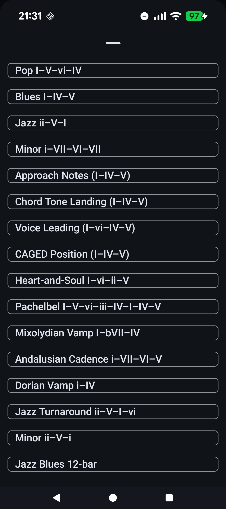

- Tap **Templates** to open a sheet of preset progressions. Templates resolve against the key currently set in the Scales screen.
- Select a template to preview the chord sequence, then press **Load** (replaces current) or **Append** (adds to the end).
- The library covers pop (I–V–vi–IV, Heart-and-Soul I–vi–ii–V, Pachelbel), modal vamps (Mixolydian I–bVII–IV, Andalusian Cadence, Dorian i–IV), jazz (ii–V–I and its turnaround variant, Minor ii–V–i, Jazz Blues 12-bar), and the original I–IV–V exercise patterns.
- Modal/minor templates assume the user is on the matching mode (Mixolydian / Minor / Dorian) for the degrees to resolve into the expected chords.
- Templates named after exercises — e.g. "Approach Notes (I–IV–V)" — are designed to be used alongside those exercises.

#### Saved progressions
- Tap **Save** to name and save the current progression.
- Tap **Saved** to expand the saved list. Tap an entry to load it; long-press to rename; tap **✕** to delete.

#### Playback
1. The current BPM is set on the **Metronome** screen and shown above the progression list.
2. Press **▶** to start looping. The metronome starts automatically at the same tempo. The active chord is highlighted.
3. Press **⏸** to stop — the metronome stops at the same time.
4. While playing, switch to the **Scales** tab to see the chord arpeggios highlighted on the fretboard in real time.
5. The fretboard also previews the **next** chord one beat early so you can see what is coming. In fullscreen, the chord-name overlay shows the current chord followed by an arrow and the upcoming chord (e.g. **C Maj → G Maj**) for that final beat.

---

### Metronome

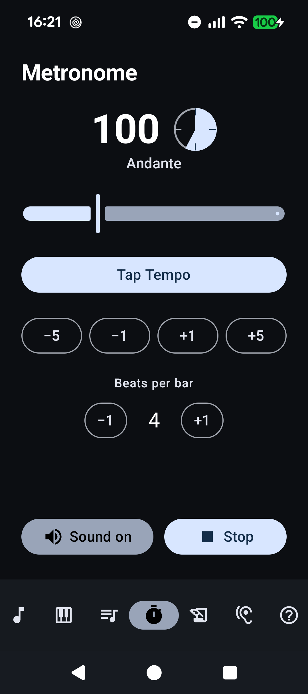

A standalone click track that also drives Progression playback tempo. Any BPM change here is immediately reflected when the Progression loops.

#### Setting the tempo
- **Drag the slider** to set BPM (20–300). The Italian tempo name (Largo, Andante, Allegro…) updates automatically.
- Use **−5 / −1 / +1 / +5** for precise nudges.
- Tap **Tap Tempo** in rhythm to derive the BPM from your playing. The BPM updates from the second tap and averages your last eight taps; pause for more than 2.5 seconds to start a fresh count.

#### Beat display
- The circle next to the BPM fills **clockwise from the top** over each bar, emptying again on the downbeat. A tick mark around the edge marks each beat.
- Use **−1** / **+1** under *Beats per bar* to set the number of beats per bar (1–12).
- Toggle **Sound on / Muted** to keep the visual pulse without audible clicks — useful when playing quietly.

#### Playback
- Press **Start** to begin clicking and **Stop** to end. The downbeat (beat 1) plays an accented click.
- In landscape, the BPM controls sit on the left and a large **Tap Tempo** button fills the right, above the playback controls.

---

### Exercises

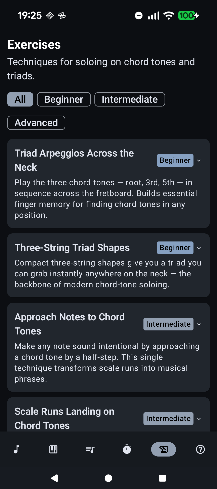

Seven structured exercises for developing chord-tone soloing and improvisation. Each card shows a difficulty badge and a one-line summary. Tap any card to expand the step-by-step instructions and a tip.

#### Difficulty levels
| Level | Exercises |
|-------|-----------|
| Beginner | Triad Arpeggios Across the Neck; Three-String Triad Shapes |
| Intermediate | Approach Notes to Chord Tones; Scale Runs Landing on Chord Tones; Triad Pairs |
| Advanced | Voice Leading Through Chord Changes; CAGED Position Soloing |

#### Using the app alongside exercises
- Several exercises ask you to build a progression — use the matching **Template** (e.g. "Approach Notes (I–IV–V)") to load it instantly.
- Use the **Scales** screen to see the active chord highlighted on the fretboard while the progression loops.
- Set a comfortable practice tempo on the **Metronome** screen before starting an exercise.
- Filter exercises by difficulty using the chips at the top of the screen.

---

### Ear Training

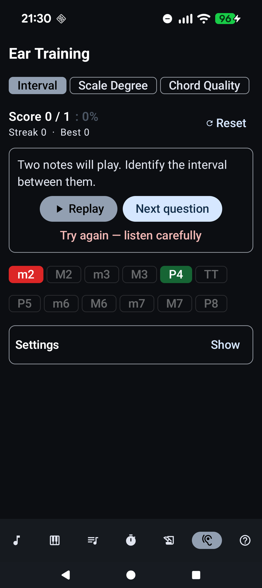

Three listen-and-pick drills for sharpening your ear. All audio is generated by the same Karplus-Strong synthesiser used elsewhere in the app.

#### Drills
- **Interval** — two notes play; identify the interval between them.
- **Scale Degree** — the root plays, then a degree of the major scale; identify which degree (I–VII) you heard.
- **Chord Quality** — a chord voicing plays; identify its quality (Major, Minor, Dim, Aug, Maj7, Min7, Dom7, HalfDim).

#### Using the drills
1. Tap the drill chips at the top to switch between **Interval**, **Scale Degree**, and **Chord Quality**. Switching resets the score.
2. Press **Start** to play the first question; tap **Replay** to hear it again. (Replay is the lighter tonal button; Start / Next question is the filled primary button.)
3. Tap an answer chip to submit your guess.
   - If you picked correctly, that chip turns **bright green**.
   - If you picked wrong, your chip turns **bright red** and the correct chip is highlighted in **dark green**.
4. Press **Next question** to advance — the Settings panel auto-collapses on each new question.
5. **Score** shows correct out of attempted, with a coloured **percentage** to its right (e.g. "Score 18 / 22 : 81 %"). The percentage stays a darker grey until 20 attempts have been made; after that it turns green when ≥ 80 % and red when < 80 %. **Streak** tracks consecutive correct answers. Press **Reset** to clear the session.

#### Settings
- **Interval drill** — toggle which intervals are in the pool (m2 through P8); multi-select **Ascending**, **Descending**, and **Harmonic** playback (the drill picks one mode at random per question, and Replay reuses it). A **Clear** button on the header empties both the pool and the playback set.
- **Scale Degree drill** — pick the root note used to anchor the major scale.
- **Chord Quality drill** — toggle which qualities are in the pool. A **Clear** button on the header empties the pool.

---

## Building and releasing

### Prerequisites
- **JDK 17** or newer and the **Android SDK** (Android Studio installs both). Compile/target SDK is 37, min SDK is 24.
- The Gradle wrapper (`./gradlew`) downloads the right Gradle version, so you don't need a separate install.

### Build and test

```bash
./gradlew assembleDebug          # debug APK  → app/build/outputs/apk/debug/app-debug.apk
./gradlew test                   # unit tests
./gradlew lint                   # lint      → app/build/reports/lint-results-debug.html
./gradlew connectedAndroidTest   # instrumented tests (needs a device or emulator)
./gradlew installDebug           # install the debug build on a connected device
```

### Release signing

Release builds are signed with the upload key described in `keystore.properties` at the project root. This file is git-ignored; never commit it or the keystore.

1. If you don't have an upload keystore yet, create one:
   ```bash
   keytool -genkeypair -v -keystore ~/keys/guitartools-upload.jks \
     -alias upload -keyalg RSA -keysize 2048 -validity 10000
   ```
2. Copy `keystore.properties.example` to `keystore.properties` and fill in the values:
   ```properties
   storeFile=/Users/you/keys/guitartools-upload.jks
   storePassword=...
   keyAlias=upload
   keyPassword=...
   ```

Without `keystore.properties` a release build still compiles, but it comes out unsigned and Play won't accept it.

### Releasing to Google Play

1. **Bump the version** in `app/build.gradle.kts`. Play rejects any upload whose `versionCode` it has already seen:
   ```kotlin
   versionCode = 24      // must increase on every upload
   versionName = "1.3"   // shown to users
   ```
2. **Build the signed bundle:**
   ```bash
   ./gradlew clean bundleSignedRelease
   ```
   The bundle is written to `app/build/outputs/bundle/release/app-release.aab`. Release builds use R8, which minifies and shrinks resources, and it writes a deobfuscation map to `app/build/outputs/mapping/release/mapping.txt`.
3. **Upload to Play Console** ([play.google.com/console](https://play.google.com/console)) → *Guitar Tools* → **Test and release**:
   - Pick the track, e.g. **Testing → Closed testing** (the current track, see [CLOSED_TESTING.md](CLOSED_TESTING.md)), **Internal testing** for a quick smoke test, or **Production**.
   - **Create new release** → upload `app-release.aab`. Play App Signing re-signs the bundle with the app signing key, so you only ever handle the upload key.
   - Upload `mapping.txt` against the new version (App bundle explorer → the version → *Downloads* → *Deobfuscation file*) so crash reports in Android vitals are readable.
   - Add release notes, then **Next → Save → Send for review**.
4. When a testing release looks good, **promote** it from its track page (*Promote release*) instead of uploading again.
5. Commit the version bump with the version as the message (e.g. `v24`), matching earlier releases.
